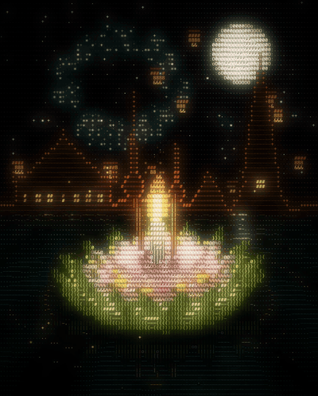

# ลอยกระทง · Loy Krathong in coloured ASCII

<p align="center"></p>

A krathong (banana-leaf float with lotus petals, marigolds, a candle and incense)
drifting on a moonlit river, with rising khom-loi lanterns, fireworks, a red
Chinese dragon flying across the sky, and Thai temple silhouettes. Every pixel is drawn with text glyphs, from one Python file.

The krathong is a real 3-D point cloud. Each frame it is projected and
z-buffered into a character grid, then lit by its flickering candle, the moon and
the golden water. Every motion is a whole multiple of a 10-second period, so the
output loops seamlessly.

Full render: [`media/krathong_showcase.mp4`](media/krathong_showcase.mp4) (1080×1920, 30 fps, with the scrolling-code panel).

Inspired by a Loy Krathong clip from the TikTok account *Python Hub*.

---

## Rendering guide

### 1. Requirements

| Need | Version | Used for |
|---|---|---|
| Python | 3.9 or newer | everything |
| numpy, Pillow | any recent | the renderer |
| ffmpeg | any recent | **video output only** (`--png` and `--term` don't need it) |
| A truecolor terminal | iTerm2, Terminal.app, Windows Terminal, kitty, WezTerm… | live `--term` mode |

Install ffmpeg:

```bash
brew install ffmpeg            # macOS
```
```bash
sudo apt install ffmpeg        # Debian / Ubuntu
```
```bash
winget install ffmpeg          # Windows
```

### 2. Set up

```bash
git clone https://github.com/Badvoic3/krathongs.git
cd krathongs
python3 -m venv .venv
.venv/bin/pip install -r requirements.txt
```

On Windows, use `.venv\Scripts\pip` and `.venv\Scripts\python` instead of `.venv/bin/...`.

### 3. Watch it live in the terminal

This runs the simulation in real time, so nothing is pre-rendered:

```bash
.venv/bin/python krathong_ascii.py --term
```

- The scene fills whatever size the terminal is. A bigger window or a smaller font
  (Cmd/Ctrl + minus) gives more detail. Resizing while it runs works.
- Press **Ctrl-C** to quit.
- It's light on resources. Each frame is rendered once (about 7–12 ms) and only the
  cells that changed are sent to the terminal. After the first 10 s loop, frames and
  diffs replay from memory (capped at about 100 MB), so CPU use drops to almost nothing.
- If colours look wrong, your terminal lacks 24-bit colour. Try iTerm2 or Windows Terminal.

### 4. Render a video

```bash
.venv/bin/python krathong_ascii.py                                     # krathong.mp4: 1080×1344, scene only
.venv/bin/python krathong_ascii.py --showcase --out showcase.mp4       # 1080×1920, scene + scrolling code panel
```

A 300-frame (10 s) render takes about 30 s on a recent laptop. Progress and ETA
are printed as it goes. The video is H.264 / yuv420p, so it plays anywhere and can
be uploaded straight to TikTok, Reels or Shorts.

### 5. Render a still

```bash
.venv/bin/python krathong_ascii.py --png 4.5              # krathong_4.5.png, the frame at t = 4.5 s
.venv/bin/python krathong_ascii.py --png 4.5 --showcase   # same, with the code panel
```

### 6. Options

| Flag | Default | Meaning |
|---|---|---|
| `--out PATH` | `krathong.mp4` | output file (`.png` with `--png`) |
| `--fps N` | `30` | frames per second; the loop is always 10 s |
| `--cols N` / `--rows N` | `108` / `84` | character grid size |
| `--cw PX` / `--ch PX` | `10` / `16` | size of one character cell in pixels |
| `--showcase` | off | add the editor-style code panel underneath (adds 576 px of height) |
| `--png T` | | render one frame at time `T` seconds |
| `--term` | | play live in the terminal |
| `--no-fireworks` | off | a quiet night, with no fireworks (works with every mode) |
| `--no-dragon` | off | leave the dragon out (works with every mode) |

The output resolution is `cols × cw` by `rows × ch`. Some examples:

```bash
.venv/bin/python krathong_ascii.py --cols 192 --rows 108 --out wide.mp4               # 1920×1728, finer glyphs
.venv/bin/python krathong_ascii.py --cols 54 --rows 42 --cw 20 --ch 32 --out chunky.mp4  # 1080×1344, big chunky glyphs
```

Keep both dimensions even, because H.264 requires it.

---

## How it works

Everything lives in [`krathong_ascii.py`](krathong_ascii.py). Each frame,
`render_cells(t)` paints a grid of cells. Each cell holds a *density* (which glyph
to use), a *colour* and a *material*, and the layers are drawn back to front:

1. **`sky_layer`**: gradient sky, twinkling stars and the full moon (limb-darkened, with maria).
2. **`lantern_layer`**: khom-loi lanterns rising and fading. Near ones are bigger and faster.
3. **`firework_layer`**: six shells per loop (peony, ring and willow bursts). Each
   rocket rises from behind the temples, bursts with a sky flash, and its streaking
   sparks sag under gravity, twinkle and fade. The flash also lights the river.
4. **`temple_layer`**: an ordination hall, chedis and a prang, outlined and warmed by the candle light.
5. **`dragon_layer`**: a red Chinese dragon crossing the sky once per loop, chasing a
   flaming pearl. Its serpentine body follows an undulating path and is shaded per
   cell as a tube, with crescent scales, gold belly plates and saw-tooth dorsal fins.
   It also has a horned head with an opening jaw, teeth and a glowing eye, a flowing
   mane, whiskers, four clawed legs that paddle in turn, and a flame-tufted tail.
6. **`water_layer`**: summed perspective waves, a mirrored skyline, the moon path,
   the candle streak, a golden pool and expanding ripples.
7. **`render_krathong`**: the 3-D float. Leaf folds, lotus petals, marigolds, candle and
   incense are built once as surface point clouds (`build_krathong`). Each frame
   they are posed (`body_pose`), projected (`project`), z-buffered per cell
   (`zbuffer`) and lit by the candle, moon, ambient light and water bounce. The
   same pass is run mirrored to draw the reflection.
8. **`flame_layer`**, **`smoke_layer`**, **`particle_layer`**: a teardrop flame with
   multi-frequency flicker, incense smoke, rising embers and fireflies.

Each material has its own glyph ramp (e.g. lotus ` .:=+oO%&@`), and density picks
the glyph. `compose_image` stamps pre-rendered glyph tiles in each cell's colour
and adds bloom. `to_ansi` turns the same grid into 24-bit ANSI escape codes for
the terminal, with a blurred glow as the background colour.
