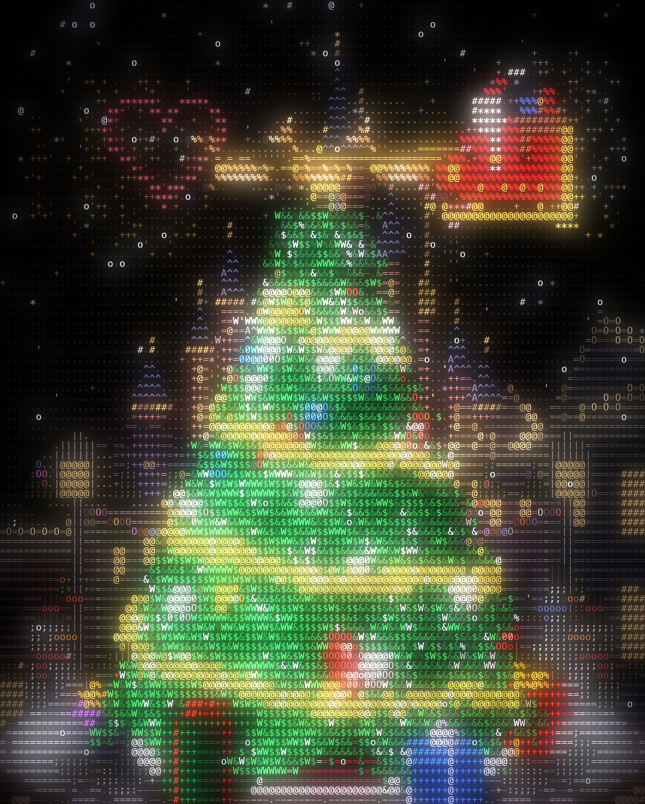
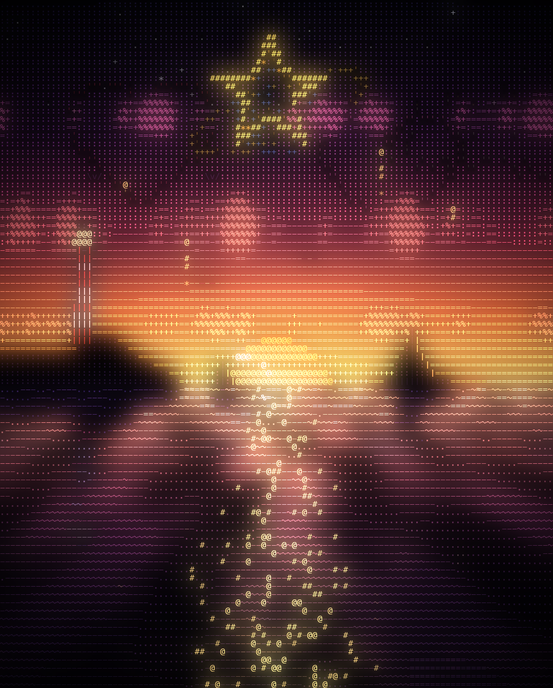
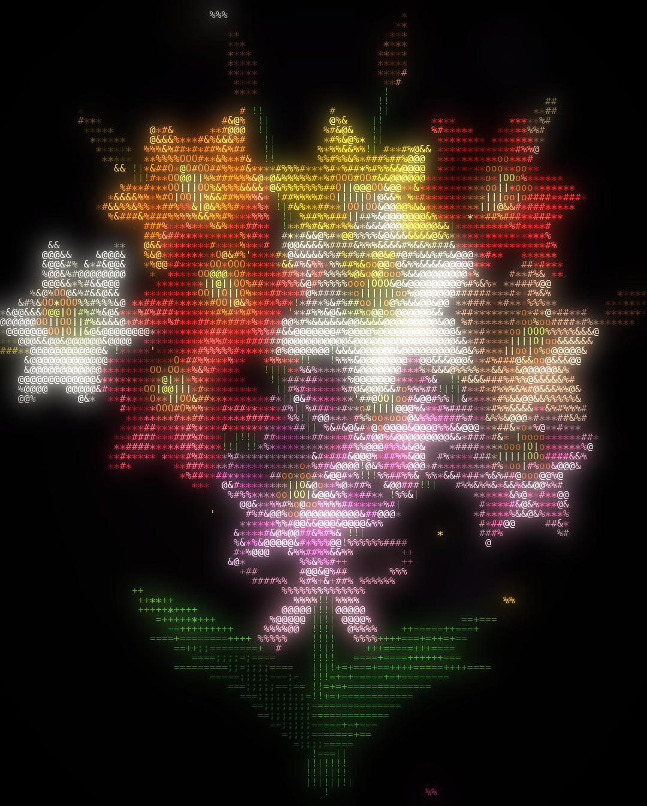

# ลอยกระทง · Loy Krathong in coloured ASCII

<p align="center"></p>

A krathong (banana-leaf float with lotus petals, marigolds, a candle and incense)
drifting on a moonlit river, with rising khom-loi lanterns, a fireworks show, a red
Chinese dragon flying across the sky, and Thai temple silhouettes. Every pixel is drawn with text glyphs, from one Python file.

The krathong is a real 3-D point cloud. Each frame it is projected and
z-buffered into a character grid, then lit by its flickering candle, the moon and
the golden water. Every motion is a whole multiple of a 10-second period, so the
output loops seamlessly.

Full render: [`media/krathong_showcase.mp4`](media/krathong_showcase.mp4) (1080×1920, 30 fps, with the scrolling-code panel).

Inspired by a Loy Krathong clip from the TikTok account *Python Hub*.

## Four scenes

| | Scene | Run it |
|---|---|---|
|  | **Loy Krathong**: the krathong on a moonlit river, lanterns, the dragon and the fireworks show. | `krathong_ascii.py` |
|  | **Castle Christmas**: a spruce builds itself in front of a fairy-tale castle: 24 whorls of drooping branches grow branch by branch, each reaching out from the trunk while the tree fills in upward, with fresh growth flashing snow-white before it melts to green. This follows the reference clip's build. It then gets dressed: a thin gold tinsel spiral draws itself on from the bottom with a white-hot head, then baubles, lights, gifts and a star. The tree stands still; chasing spiral lights, a glittering wave rising up it, sliding glints on the baubles and a star with turning, pulsing rays keep it lively while the fireworks loop. The plaza has a toy train circling the tree, a walking snowman, snowmen, lamp posts, lit shrubs, a Main Street of shopfronts with marquee bulbs and string lights, a crowd with Santa hats and balloons, and Santa's sleigh (sack of gifts, reins, three galloping reindeer with antlers and bells) circling the castle. | `castle_tree.py` |
|  | **Sunset Sea**: a big striped sun on the horizon under a purple-to-gold sky, a golden road across the waves, surf rolling onto the beach, palm silhouettes framing the view, plus a lighthouse beam, sailboats and gulls. The water mirrors every firework. | `sunset_sea.py` |
|  | **Lily Bouquet**: green shoots rise, leaves arch out from the base and slim buds swell on the stem tips. Then each lily blooms in turn: its petals peel open from the tip, outer three first, curl back and turn to face you, revealing freckled throats, stamens and anthers, with a little sparkle. A satin ribbon wraps the stems and ties a bow, then the bouquet sways in the breeze while pollen drifts, bokeh glows and petals fall. No fireworks. | `lily_bouquet.py` |

Running a scene plays it **live in your terminal**: no flags needed. The castle scene starts
with the tree building itself, then the show loops every 20 s, with the tree in focus and the
park softly dimmed behind it.

```bash
.venv/bin/python krathong_ascii.py
```
```bash
.venv/bin/python castle_tree.py
```
```bash
.venv/bin/python sunset_sea.py
```
```bash
.venv/bin/python lily_bouquet.py
```

Add `--video` to render a video file instead (the castle video includes the build, then `--loops` loops):

```bash
.venv/bin/python castle_tree.py --video --loops 3       # castle_tree.mp4: build + three 20 s loops
.venv/bin/python sunset_sea.py --showcase               # 1080x1920 video with the scrolling code panel
```

Every scene takes the same flags (below), and all of them share one engine and fireworks show in
`krathong_ascii.py`.

The castle build is inspired by an ASCII Christmas-tree
clip from the TikTok account *dwcminh.ascii*, and the bouquet by an ASCII lily clip from *arimecoa*. The castle, the park and the show are original designs.

---

## Rendering guide

### 1. Requirements

| Need | Version | Used for |
|---|---|---|
| Python | 3.9 or newer | everything |
| numpy, Pillow | any recent | the renderer |
| ffmpeg | any recent | **video output only** (`--video` / `--showcase`) |
| A truecolor terminal | iTerm2, Terminal.app, Windows Terminal, kitty, WezTerm… | live playback (the default) |

Install ffmpeg:

```bash
brew install ffmpeg            # macOS
```
```bash
sudo apt install ffmpeg        # Debian / Ubuntu
```
```bash
winget install ffmpeg          # Windows
```

### 2. Set up

```bash
git clone https://github.com/Badvoic3/krathongs.git
cd krathongs
python3 -m venv .venv
.venv/bin/pip install -r requirements.txt
```

On Windows, use `.venv\Scripts\pip` and `.venv\Scripts\python` instead of `.venv/bin/...`.

### 3. Watch it live in the terminal

This is the default. It runs the simulation in real time, so nothing is pre-rendered:

```bash
.venv/bin/python krathong_ascii.py
```

- The scene fills whatever size the terminal is. A bigger window or a smaller font
  (Cmd/Ctrl + minus) gives more detail. Resizing while it runs works.
- Press **Ctrl-C** to quit.
- It's light on resources, even full screen. Only cells that visibly changed are sent
  to the terminal (tiny colour shimmer is held back until it adds up), which keeps the
  terminal app's own drawing (GPU) work low. The first pass of the loop is rendered
  live; after that the compressed frame diffs replay from memory (about 10–25 MB), so
  CPU use drops to about 2% of one core.
- The frame rate adapts to the terminal size: 30 fps normally, 24 or 20 in very large
  terminals. Use `--fps N` to choose.
- If colours look wrong, your terminal lacks 24-bit colour. Try iTerm2 or Windows Terminal.

### 4. Render a video

```bash
.venv/bin/python krathong_ascii.py --video                             # krathong.mp4: 1080×1344, scene only
.venv/bin/python krathong_ascii.py --showcase --out showcase.mp4       # 1080×1920, scene + scrolling code panel
```

A 300-frame (10 s) render takes about 30 s on a recent laptop. Progress and ETA
are printed as it goes. The video is H.264 / yuv420p, so it plays anywhere and can
be uploaded straight to TikTok, Reels or Shorts.

### 5. Render a still

```bash
.venv/bin/python krathong_ascii.py --png 4.5              # krathong_4.5.png, the frame at t = 4.5 s
.venv/bin/python krathong_ascii.py --png 4.5 --showcase   # same, with the code panel
```

### 6. Options

| Flag | Default | Meaning |
|---|---|---|
| `--out PATH` | `krathong.mp4` | output file (`.png` with `--png`) |
| `--fps N` | `30` video / auto live | frames per second (live picks 30, 24 or 20 by terminal size) |
| `--cols N` / `--rows N` | `108` / `84` | character grid size |
| `--cw PX` / `--ch PX` | `10` / `16` | size of one character cell in pixels |
| `--showcase` | off | add the editor-style code panel underneath (adds 576 px of height) |
| `--video` | off | render a video file instead of playing live (implied by `--showcase` or an `.mp4` `--out`) |
| `--png T` | | render one frame at time `T` seconds |
| `--term` | on | play live in the terminal (the default; overrides the video flags) |
| `--no-fireworks` | off | no fireworks (works with every mode) |
| `--no-dragon` | off | leave the dragon out (krathong scene only) |
| `--loops N` | `1` | how many loops a video includes after any intro |

The output resolution is `cols × cw` by `rows × ch`. Some examples:

```bash
.venv/bin/python krathong_ascii.py --cols 192 --rows 108 --out wide.mp4               # 1920×1728, finer glyphs
.venv/bin/python krathong_ascii.py --cols 54 --rows 42 --cw 20 --ch 32 --out chunky.mp4  # 1080×1344, big chunky glyphs
```

Keep both dimensions even, because H.264 requires it.

---

## How it works

Everything lives in [`krathong_ascii.py`](krathong_ascii.py). Each frame,
`render_cells(t)` paints a grid of cells. Each cell holds a *density* (which glyph
to use), a *colour* and a *material*, and the layers are drawn back to front:

1. **`sky_layer`**: gradient sky, twinkling stars and the full moon (limb-darkened, with maria).
2. **`lantern_layer`**: khom-loi lanterns rising and fading. Near ones are bigger and faster.
3. **`firework_layer`**: a choreographed theme-park-style show timed to the 10 s loop,
   built by `build_show`. It uses comet fans, ground fountains and mines, chrysanthemums
   with pistils, a palm, crossettes that split in four, hearts, a ringed planet, a star,
   rings in rings, butterflies, swimming fish, many-coloured dahlias, gold willows and a
   kamuro with crackle, horsetails, and a strobing finale. Shells are paired, but each
   partner gets its own delay, offset, size, colour and often type, so the show is never
   mirrored. Every shell flashes the sky and lights the water.
4. **`temple_layer`**: an ordination hall, chedis and a prang, outlined and warmed by the candle light.
5. **`dragon_layer`**: a red Chinese dragon crossing the sky once per loop, chasing a
   flaming pearl. Its serpentine body follows an undulating path and is shaded per
   cell as a tube, with crescent scales, gold belly plates and saw-tooth dorsal fins.
   It also has a horned head with an opening jaw, teeth and a glowing eye, a flowing
   mane, whiskers, four clawed legs that paddle in turn, and a flame-tufted tail.
6. **`water_layer`**: summed perspective waves, a mirrored skyline, the moon path,
   the candle streak, a golden pool and expanding ripples.
7. **`render_krathong`**: the 3-D float. Leaf folds, lotus petals, marigolds, candle and
   incense are built once as surface point clouds (`build_krathong`). Each frame
   they are posed (`body_pose`), projected (`project`), z-buffered per cell
   (`zbuffer`) and lit by the candle, moon, ambient light and water bounce. The
   same pass is run mirrored to draw the reflection.
8. **`flame_layer`**, **`smoke_layer`**, **`particle_layer`**: a teardrop flame with
   multi-frequency flicker, incense smoke, rising embers and fireflies.

Each material has its own glyph ramp (e.g. lotus ` .:=+oO%&@`), and density picks
the glyph. `compose_image` stamps pre-rendered glyph tiles in each cell's colour
and adds bloom. `to_ansi` turns the same grid into 24-bit ANSI escape codes for
the terminal, with a blurred glow as the background colour.
